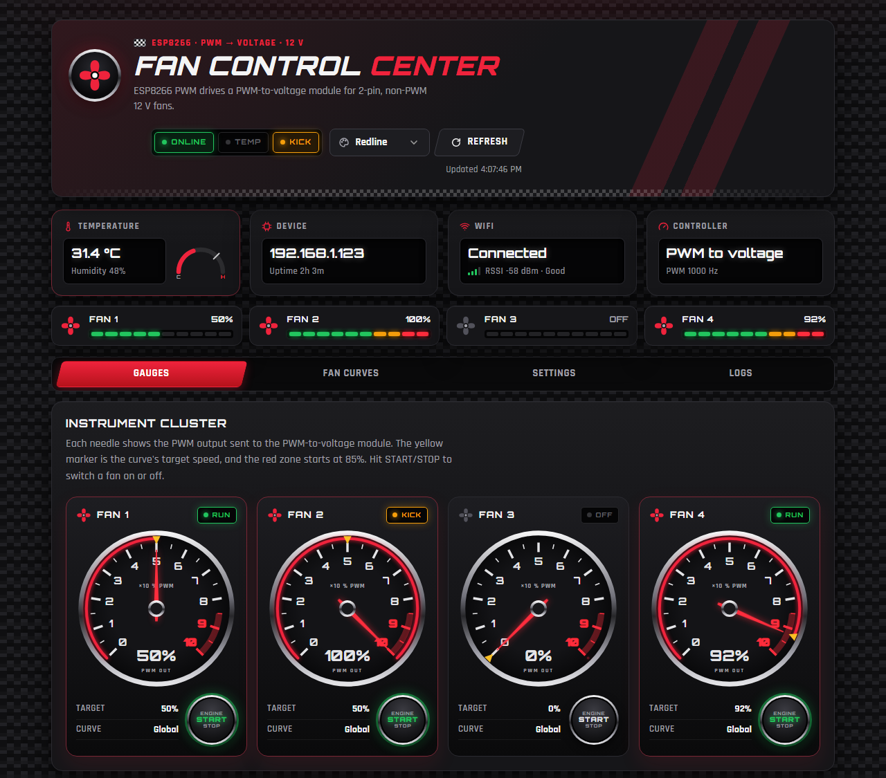
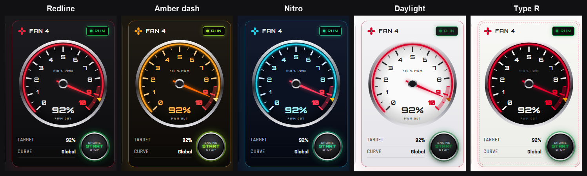
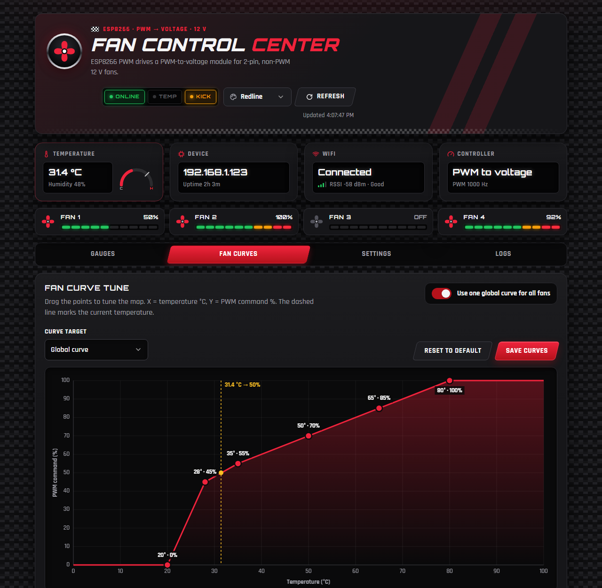
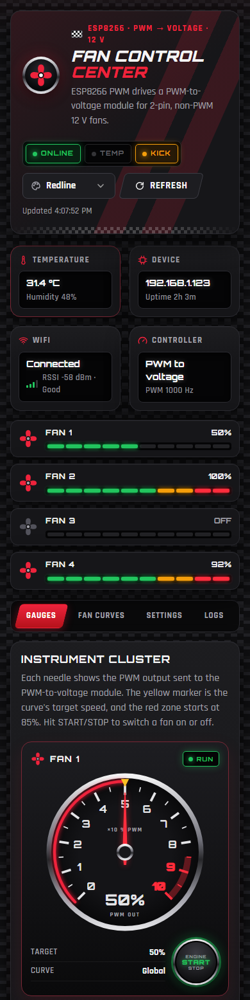

# ESP8266 PWM-to-Voltage Fan Controller Package

This version is for a 2-pin non-PWM 12V fan driven by a separate PWM-to-voltage / PWM-to-DC controller module.

## What changed from the MOSFET-only version?

The ESP8266 no longer directly switches fan power through a MOSFET stage. Instead:

```text
ESP8266 GPIO PWM signal → PWM-to-voltage module control input
PWM-to-voltage module output → 12V 2-pin fan
```

The web UI still shows speed as percent, but in this version it means the PWM command sent to the PWM-to-voltage module.

## Screenshots

These show sample data, not a live device.

**Instrument cluster.** One tachometer per fan. The needle shows the PWM output, the yellow marker the curve's target, and the red zone starts at 85%. Fan 2 is getting its startup kick, so its needle sits at 100% above a 50% target.



**Themes.** Pick one from the theme menu in the header. Auto follows your system: Redline in dark mode, Daylight in light mode.



**Fan curve editor.** Drag the points to set PWM % against temperature. The dashed line marks the current temperature.



**On a phone.**



## Files

- `firmware/ESP8266_PWM_To_Voltage_FanController/ESP8266_PWM_To_Voltage_FanController.ino`
- `web/index.html`
- `web/style.css`
- `web/app.js`
- `docs/pwm_to_voltage_schematic.svg`
- `docs/README.md`
- `docs/screenshots/` (images used in this README)

## Firmware setup

1. Install Arduino IDE.
2. Install ESP8266 board support.
3. Install libraries:
   - DHT sensor library by Adafruit
   - Adafruit Unified Sensor
   - ArduinoJson v6
4. Open the `.ino` file.
5. Edit WiFi credentials:
   ```cpp
   #define WIFI_SSID "YOUR_WIFI_SSID"
   #define WIFI_PASSWORD "YOUR_WIFI_PASSWORD"
   ```
6. Upload to ESP8266.
7. Open Serial Monitor at 115200 baud.
8. Copy the ESP8266 IP address.
9. Host the `web` folder on a web server (see [Deploying the web UI](#deploying-the-web-ui)) and enter the ESP8266 API URL.

## Deploying the web UI

The dashboard is three static files (`index.html`, `style.css`, `app.js`). The ESP8266 serves only the JSON API (`/api/status`, `/api/config`, `/api/fan`). The dashboard runs in your browser and calls that API directly, so you can host it on any static web server on your network. The steps below use nginx on a Raspberry Pi or another Debian/Ubuntu machine.

Before you start:

- The browser showing the dashboard must be able to reach the ESP8266 on your LAN.
- Serve the dashboard over plain **HTTP**. The ESP8266 API is `http://`, and browsers block `http://` requests from an `https://` page (mixed content). If you need HTTPS, use the [reverse proxy](#optional-proxy-the-api-through-nginx) option.
- The fonts load from Google Fonts. Without internet access the page still works but falls back to system fonts.

### Option 1: nginx (recommended)

1. Install nginx:
   ```bash
   sudo apt update
   sudo apt install nginx
   ```
2. Copy the web files into the default web root:
   ```bash
   sudo mkdir -p /var/www/html/fan-controller
   sudo cp web/index.html web/style.css web/app.js /var/www/html/fan-controller/
   ```
3. Open `http://<server-ip>/fan-controller/` in a browser.

   The stock nginx site already serves `/var/www/html`, so no config change is needed. To give the dashboard its own server block instead, use `docs/nginx-example.conf`:
   ```bash
   sudo cp docs/nginx-example.conf /etc/nginx/sites-available/fan-controller
   sudo nano /etc/nginx/sites-available/fan-controller   # set server_name to your server's IP or hostname
   sudo ln -s /etc/nginx/sites-available/fan-controller /etc/nginx/sites-enabled/
   sudo nginx -t && sudo systemctl reload nginx
   ```

### Option 2: quick test without nginx

From the `web` folder, run any static server, for example:

```bash
cd web
python3 -m http.server 8080
```

Then open `http://localhost:8080`. Opening `index.html` straight from disk also works for a quick check.

### Connect the dashboard to the ESP8266

1. Open the dashboard. On first load it opens on the **Settings** tab.
2. Under **Connection**, enter the ESP8266 address from the Serial Monitor, e.g. `http://192.168.1.123` (`http://` is added automatically if you leave it off).
3. Click **Test URL** to check it, then **Save & connect**. The **ONLINE** lamp lights up and the gauges start updating every 5 seconds.

The URL is saved in your browser's localStorage, so each browser or device needs to enter it once. Give the ESP8266 a DHCP reservation on your router so its IP doesn't change.

### Updating the dashboard

Copy the changed files over the old ones:

```bash
sudo cp web/index.html web/style.css web/app.js /var/www/html/fan-controller/
```

Then hard-refresh the browser (Ctrl+F5 or Cmd+Shift+R) so it doesn't keep cached copies.

### Optional: proxy the API through nginx

nginx can forward API calls to the ESP8266, so the browser only ever talks to the nginx server. This makes HTTPS possible and avoids cross-origin requests. Add this inside your `server { ... }` block, replacing the IP with your ESP8266's:

```nginx
location /fan-controller/api/ {
    proxy_pass http://192.168.1.123/api/;
    proxy_connect_timeout 5s;
    proxy_read_timeout 10s;
}
```

Reload nginx, then set the dashboard's API URL to the nginx address including the path, e.g. `http://<server-ip>/fan-controller` (or `https://...` if nginx has TLS).

### Troubleshooting

| Symptom | Check |
|---|---|
| **OFFLINE** lamp, log says "Network error" | Is the ESP8266 IP right? Try `curl http://<esp-ip>/api/status` from the server, or open that URL in the browser. |
| Works on `http://`, fails on `https://` | Mixed content. Serve the dashboard over HTTP or use the nginx proxy above. |
| "Timed out after 4s" | The ESP8266 is busy or has weak WiFi. Check the RSSI on the WiFi card and the Serial Monitor. |
| Old look after updating files | The browser cached the old files. Hard-refresh (Ctrl+F5). |
| 404 from nginx | Check that the files are in `/var/www/html/fan-controller/` and the URL ends with `/fan-controller/`. |

## Default pins

| Function | NodeMCU pin | GPIO |
|---|---:|---:|
| DHT11 data | D4 | GPIO2 |
| Fan 1 PWM control | D1 | GPIO5 |
| Fan 2 PWM control | D2 | GPIO4 |
| Fan 3 PWM control | D5 | GPIO14 |
| Fan 4 PWM control | D6 | GPIO12 |

## PWM frequency

Default:

```cpp
const uint16_t PWM_FREQ_HZ = 1000;
```

Many PWM-to-voltage modules work well at 500 Hz or 1000 Hz. Check your module documentation.

## Wiring reminder

- ESP8266 GND must connect to PWM-to-voltage module GND.
- 12V PSU GND should be common with the module and ESP8266 GND unless your module is opto-isolated and its manual says otherwise.
- Do not connect 12V to ESP8266 GPIO.
- Make sure the module PWM input accepts 3.3V logic. If it needs 5V PWM, use a logic-level shifter or transistor buffer.
